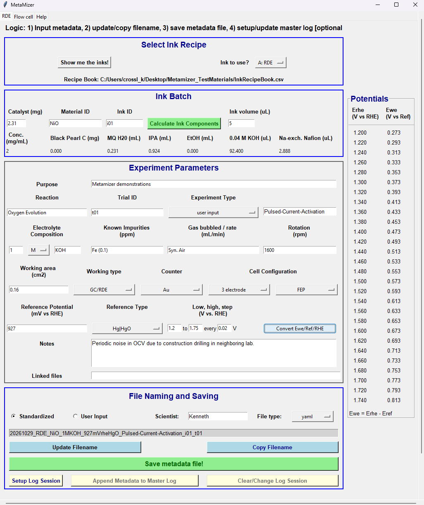
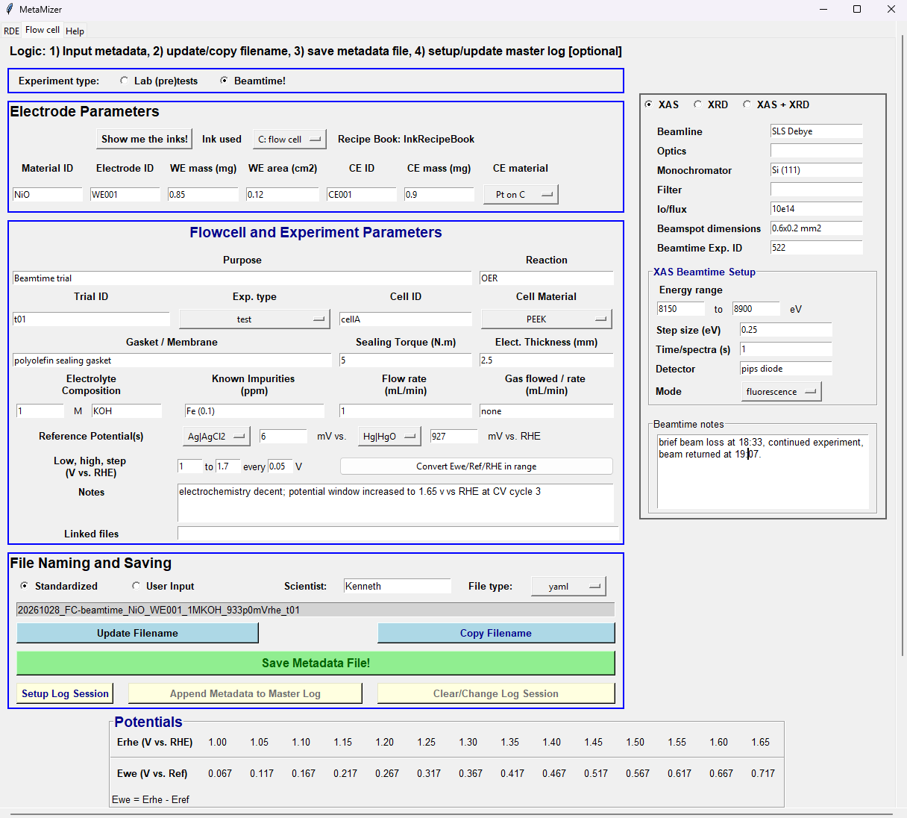

# Metamizer

**Author:** Kenneth W. Crossley

**Affiliation:** Paul Scherrer Institute (PSI), Villigen, Switzerland

**Correspondence:** Emiliana Fabbri (emiliana.fabbri@psi.ch)

**Version:** 3.0

---

## Overview

Metamizer is a graphical metadata acquisition tool designed to improve metadata completeness, reproducibility, and FAIR (Findable, Accessible, Interoperable, and Reusable) data practices in electrochemistry and synchrotron-based experiments.

By capturing metadata at the point of data acquisition, Metamizer reduces transcription errors, standardizes experimental documentation, and facilitates long-term data reuse. The current implementation has been optimized for rotating disk electrode (RDE) experiments and synchrotron-based operando characterization measurements, while remaining adaptable to additional electrochemical workflows.

---

## Contents

- [Overview](#overview)
- [Why Metamizer?](#why-metamizer)
- [Features](#features)
- [Installation](#installation)
- [Quick Start](#quick-start)
- [Repository Structure](#repository-structure)
- [Example Output](#example-output)
- [Workflow](#workflow)
  - [RDE Tab](#rde-tab)
  - [Beamtime--Flowcell-Tab](#beamtime--flowcell-tab)
  - [Metadata Export](#metadata-export)
  - [Master Log Integration](#master-log-integration)
- [Screenshots](#screenshots)
- [Dependencies](#dependencies)
- [Quality Control](#quality-control)
- [Known Limitations](#known-limitations)
- [Reuse Potential](#reuse-potential)
- [Contributing and Support](#contributing-and-support)
- [Citation](#citation)
- [License](#license)
- [Declarations](#declarations)

---

## Why Metamizer?

Metamizer was developed to improve metadata completeness, experimental reproducibility, and FAIR data practices in electrochemistry and synchrotron experiments.

Metadata are often recorded retrospectively, resulting in transcription errors, incomplete records, and inconsistencies between experimental datasets. Metamizer addresses this problem by capturing metadata alongside experimental execution, producing structured machine-readable records suitable for long-term storage, sharing, data extraction, and reuse.

The software is particularly suited to laboratories performing:

- Rotating disk electrode (RDE) experiments
- Oxygen evolution reaction (OER) studies
- Operando XAS measurements
- Operando XRD measurements
- Synchrotron beamline experiments
- FAIR-compliant data management workflows

---

## Features

- Guided metadata entry for rotating disk electrode (RDE) experiments
- Guided metadata entry for synchrotron beamtime experiments
- Automatic ink component calculations using recipe books
- Standardized filename generation
- YAML metadata export
- JSON metadata export
- Master-log integration for experiment tracking
- Reference electrode calibration support
- Potential conversion utilities
- FAIR-aligned metadata capture
- Human-readable and machine-readable metadata outputs
- Configurable laboratory workflows

---

## Installation

Download the latest release and launch:

```text
Metamizer_v3.exe
```

The standalone windows executable includes all required dependencies and does not require a separate Python installation.

For the latest version, download the appropriate release/source code from the GitHub page.

---

## Quick Start

1. Download the latest Metamizer release.
2. Launch `Metamizer_vXX.exe`.
3. Load an ink recipe book CSV.
4. Enter experiment metadata.
5. Generate a standardized filename.
6. Export metadata as YAML or JSON.
7. Optionally append metadata to a master log.

A complete metadata record can typically be generated in less than one minute once configuration files have been established.

---

## Repository Structure

```text
Metamizer/
├── Metamizer.exe         # Standalone Windows application
├── Metamizer_v3.py       # python source code
├── dist/                 # full python environment with local refs for directory-based .exe (copyable for easy distribution)
├── examples/             # Example configuration and metadata files
├── images/               # GUI screenshots
├── LICENSE
└── README.md
```

---

## Example Output

Metamizer exports metadata in structured machine-readable formats suitable for long-term storage, archiving, and FAIR data management.

### Example YAML Metadata

```yaml
file_metadata:
  creator: Kenneth
  created_date: '2026-10-28 17:55:48'
  filename_mode: standardized
  generated_filename: 20261028_FC-beamtime_NiO_WE001_1MKOH_933p0mVrhe_t01
  linked_files: ''
ink_recipe:
  recipe_book: InkRecipeBook
  selected_ink_recipe: 'C: flow cell'
  material_id: NiO
experiment_parameters:
  exp_purpose: Beamtime trial
  reaction: OER
  trial_id: t01
  exp_type: test
  working_electrode:
    material_id: NiO
    electrode_id: WE001
    electrode_mass_mg: 0.85
    electrode_area_cm2: 0.12
  counter_electrode:
    CE_id: CE001
    CE_mass_mg: 0.9
    CE_type: Pt on C
  electrolyte:
    concentration_M: '1'
    composition: KOH
    known_impurities_ppm: Fe (0.1)
    liquid_flowrate_mLpermin: '1'
    gas_flowrate_mLpermin: none
  reference_electrode_1:
    ref_type: Ag|AgCl2
    mV_vs_rhe: 6.0
  reference_electrode_2:
    ref_type: Hg|HgO
    mV_vs_rhe: 927.0
  flowcell_details:
    gasket_membrane: polyolefin sealing gasket
    torque_Nm: 5.0
    electrolyte_thickness_mm: 2.5
    cell_id: cellA
    cell_material: PEEK
notes: 'electrochemistry decent; potential window increased to 1.65 v vs RHE at CV
  cycle 3

  '
beamtime_parameters:
  beamtime_exp_id: '522'
  tecnique: XAS
  beamline: SLS Debye
  optics: ''
  monochromator: Si (111)
  filter: ''
  I0: 10e14
  beamspot: 0.6x0.2 mm2
  beamtime_notes: 'brief beam loss at 18:33, continued experiment, beam returned at
    19:07.

    '
  xas_parameters:
    energy_min_eV: 8150.0
    energy_max_eV: 8900.0
    steps: 0.25
    frequency: 1.0
    detector: pips diode
    detection_mode: fluorescence

```

---

## Workflow

### RDE Tab

The RDE tab is designed for rotating disk electrode experiments and associated electrochemical characterization.

Users enter experimental metadata, select materials, define electrolyte conditions, and record parameters relevant to electrochemical operation. Information is validated in real time and incorporated into standardized filenames and metadata outputs.

The tab integrates recipe-book functionality that simplifies the entry of catalyst ink compositions and minimizes manual transcription.

### Beamtime / Flowcell Tab

The Beamtime tab supports synchrotron-based experiments, including operando XAS/XRD and related flowcell measurements.

Additional metadata are collected for beamline operation, cell configuration, experimental setup, and calibration information.

Metamizer supports recording multiple reference electrode values and associated calibration information to improve traceability and reproducibility of synchrotron experiments.

### Metadata Export

All metadata can be exported in structured formats suitable for:

- Experimental archiving
- Data sharing
- FAIR data workflows
- Automated downstream processing/parameter extraction
- Long-term data stewardship

Supported export formats include:

- YAML
- JSON

### Master Log Integration

Metadata records may optionally be appended to a centralized laboratory master log.

The master log aggregates a user-selected subset of metadata variables, one row per experiment, into a single *.csv* file. 

A log session is initiated with the 'Setup Log Session' button and requires two *.csv* files:

1. **A configuration file** that links Python variable names to human-readable column labels. The required columns are `variable_name` and `column_label`. Not every variable collected by the software is relevant to day-to-day experiment tracking, so the configuration file allows users to select only the variables of interest and to label them legibly according to their preference. A registry of the currently available variable names can be opened in the Help tab and is available in the `[examples/]`.

Example configuration file (labels are illustrative):

```csv
variable_name,column_label
str_author,Author
str_material_id, Batch code
str_trial_id,Trial ID
str_electrolyte_conc,Concentration (M)
str_electrolyte_chem,Electrolyte
ent_notes,Notes
```
A `Timestamp` column is prepended automatically on every append and must not be listed in the configuration file; because it is not a registry variable, such an entry is rejected as an unknown variable.

2. **A master log file.** An existing log may be opened; if none exists, the program creates one.

Once the session is established, the user may append as many rows as desired with the 'Append Metadata to Master Log' button. Current widget values are read fresh on every append, so incrementing the trial identifier or changing any other field between appends is reflected automatically. The 'Clear/Change Log Session' button removes the current session from memory and enables new configuration and master log files to be selected, which is necessary if the wrong log was loaded or the type of experiment changes. Note that one row is appended each time the button is pressed, so duplicate rows are possible if the metadata are not updated between clicks.

---

## Screenshots

### RDE Tab



### Beamtime Tab



---

## Dependencies

The standalone executable includes all required dependencies.

For users running the source code, Metamizer depends on:

| Dependency | Purpose |
|------------|----------|
| Python 3.11+ | Runtime environment |
| Tkinter | Graphical user interface (standard python library) |
| json | json generation (standard python library) |
| pandas | CSV handling and data processing |
| NumPy | Numerical calculations |
| SciPy | Scientific calculations |
| PyYAML | YAML generation and export |

---

## Quality Control

This software incorporates automated input validation to reduce manual entry errors and improve metadata consistency.

Validation includes:

- Required field checking
- Type validation
- Metadata completeness checks
- Consistency verification between experimental parameters

Additional quality-control measures should continue to be performed by users according to local laboratory procedures and experimental requirements. Example *.yaml* files are present in the `[examples/]`. 

---

## Known Limitations

Current limitations include:

- Workflow optimization is focused on dropcast/spray-coated electrocatalyst and synchrotron experiments.
- The graphical interface is designed around predefined metadata structures.
- New workflows may require modification of configuration files and supporting templates.
- Some project-specific naming schemes may require customization.

Future development may expand support for additional experimental techniques and metadata schemas.

---

## Reuse Potential

Metamizer was intentionally developed with extensibility in mind.

Although initially designed for electrochemical and synchrotron-based experiments, the underlying workflow is broadly applicable to scientific metadata management where reproducibility, traceability, and structured data collection are required.

Potential future applications include:

- Additional electrochemical techniques
- Operando spectroscopy workflows
- Materials characterization platforms
- Automated laboratory data pipelines
- FAIR-compliant research data infrastructures

The modular architecture and configuration-based approach facilitate adaptation to new experimental environments with minimal modification of the core workflow.

---

## Contributing and Support

Questions, bug reports, feature requests, and software support requests should be submitted through the GitHub Issues page.

If you encounter a problem or have suggestions for improvements, please open an issue through the GitHub repository and provide sufficient information to reproduce the issue whenever possible.

For scientific questions regarding methodology or implementation, please contact the correspondence contact.

---

## Citation

If you use Metamizer in published research, please cite the associated publications:

K. Crossley. Enhancement Strategies and Local Structure-Activity Relationaships in Transition Metal Oxygen Evolution Reaction Catalysts. Doctoral thesis, ETH Zurich, 2026. https://doi.org/10.3929/ethz-c-000806719

If a software DOI is available, please also cite the corresponding software release.

---

## License

This project is distributed under the BSD 3-Clause License.

See the `LICENSE` file for full license terms.

---

## Declarations

### Funding

Ancilary development via Swiss National Science Foundation PRIMA grant (grant No. PR00P2_193111).

### Conflicts of Interest

The authors declare no conflicts of interest.

### Acknowledgements
The authors thank the participants of the panel discussions on reproducibility at the EcatalytiX conferences for the inspiration for this work. Thanks to Jan Grotheer and Sara Sumbal for beta testing. Thanks to Emiliana Fabbri, Juliana Brunelli Falqueto, Marija Zoric, Natasha Hales, Javier Quilez Bermejo, Tim Welmers, and Mateusz Wojtas for suggestions on metadata fields and GUI design flow.
